# 轨迹提取流程的实现进度

这张图和 `docs/workflow.md` 的流程图结构相同，只是把节点的颜色换成了实现状态。流程本身的定义以 `docs/workflow.md` 为准；两张图需要手工保持一致，流程图的节点有变化时，这里要同步修改。

| 图上的样式 | 含义 |
|---|---|
| 绿色实心 | 已经实现 |
| 绿色虚线边框 | 部分实现 |
| 红色实心 | 还没有开始 |

```mermaid
flowchart TD
    classDef done fill:#bbf7d0,stroke:#16a34a,stroke-width:2px,color:#14532d
    classDef partial fill:#ffffff,stroke:#16a34a,stroke-width:3px,stroke-dasharray:6 4,color:#14532d
    classDef todo fill:#fecaca,stroke:#dc2626,stroke-width:2px,color:#7f1d1d

    START([开始：合并后的对话文件]) --> CUT
    CUT["代码：按时间顺序切成单元<br/>用户消息 / AI 发言 / 用户信号 / 工具调用 / 观测<br/>跳过思考、状态行、压缩摘要"]
    CUT --> ZIP
    ZIP["LLM：并行做第一级压缩<br/>每个调用的意图 [意图文本, evidence, explicit, note] + 对象<br/>每个结果的概括"]
    ZIP --> PTR

    PTR["代码：指针移到下一个单元"]
    PTR --> PREP["LLM：发言切出下一段，附带意图，带全部 topic 的图谱<br/>其他单元直接往下走"]
    PREP --> ISRES{是工具结果？<br/>用户拒绝产生的结果除外}
    ISRES -- 是 --> INHERIT["代码：沿用产生它的工具调用的 topic"]
    ISRES -- 否 --> T["调用 T：这个单元属于哪个 topic？<br/>输出 已有 topic 编号<br/>或 NEW + 新 topic 的标题"]
    T --> VT{"校验 T<br/>编号在 topic 列表里？<br/>NEW 时标题非空？"}
    VT -- 不通过 --> T
    VT -- 通过 --> NEWT["代码：NEW 时登记新 topic<br/>建对应的存储文件，写一条运行日志"]
    NEWT --> KIND
    INHERIT --> KIND
    KIND{单元类型？}

    KIND -- "用户段落 / AI 段落 / 用户信号 / 工具调用" --> CTX
    KIND -- "观测" --> CTXD

    CTX["代码：组装 context<br/>header：topic 列表、当前 topic、<br/>单元信息、当前 topic 的整张图谱、候选<br/>input：窗口内的对话 + 当前单元"]

    CTX --> SRC{意图从哪里来？}
    SRC -- 用户段落或 AI 段落 --> SEGI["代码：取切分给出的意图"]
    SRC -- 工具调用 --> ZIPI["代码：取第一级压缩给出的意图"]
    SEGI -- 空列表 --> SPAN
    SEGI -- 非空 --> RET
    ZIPI --> G
    SRC -- 用户信号 --> A["调用 A：这个用户信号有哪些意图？<br/>输出 [意图文本, evidence, explicit, note]<br/>可以是空列表"]
    A --> VA{"校验 A<br/>每项字段齐全？<br/>evidence 是单元原文的摘录？<br/>explicit 为 false 时 note 非空？"}
    VA -- 不通过 --> A
    VA -- "通过，空列表" --> SPAN
    VA -- "通过，非空" --> RET["代码：列出候选<br/>调用 B：当前 topic 里同一方（用户或 AI）的意图节点<br/>调用 C：当前 topic 里出自其他发言的节点 + 窗口内能单独看到的未建节点观测<br/>（用户拒绝时被拒绝调用所属的聚合已在全部节点里）"]

    RET --> HAS{当前 topic 已有同一方的意图节点？}
    HAS -- "没有：全部算作 NEW" --> ASSIGN
    HAS -- 有 --> B["调用 B：每个意图是已有的哪一个？<br/>输出 已有编号或 NEW<br/>+ 已有意图是否完整包含这个单元的信息"]
    B --> VB{"校验 B<br/>答案和本单元的意图一一对应？<br/>选的编号在候选列表里？<br/>选已有编号的都回答了完整性？"}
    VB -- 不通过 --> B
    VB -- 通过 --> ASSIGN["代码：同一单元内重复的编号去重<br/>给 NEW 和“不完整”的意图分配新编号<br/>填 type / actor"]

    ASSIGN --> C
    G["调用 G：这个调用的每个底层意图<br/>属于哪个已有聚合？<br/>input 多一段当前单元之后的内容<br/>输出 已有聚合编号<br/>或 NEW + 聚合的标准文本"]
    G --> VG{"校验 G<br/>答案和本单元的意图一一对应？<br/>选的编号是当前 topic 的聚合？<br/>NEW 时标准文本非空？"}
    VG -- 不通过 --> G
    VG -- 通过 --> LHAS{"代码：归入的聚合<br/>已有底层意图？"}
    LHAS -- "没有：全部算作 NEW" --> GASSIGN
    LHAS -- 有 --> L["调用 L：每个底层意图是这个聚合<br/>已有的哪一个？<br/>输出 已有 L 编号或 NEW<br/>每个有成员的聚合调用一次"]
    L --> VL{"校验 L<br/>答案和这个聚合的底层意图一一对应？<br/>选的编号是这个聚合的成员？"}
    VL -- 不通过 --> L
    VL -- 通过 --> GASSIGN
    GASSIGN["代码：给 NEW 分配 G 编号<br/>同一个底层意图沿用原 L 编号，其余分配新 L 编号<br/>登记进 meta.tool_intents，段落引用 L 编号"]
    GASSIGN --> C
    C["调用 C：这个单元的每个意图<br/>和候选之间有关系吗？<br/>输出 [起点编号, 终点编号, relation 枚举, evidence]"]
    C --> VC{"校验 C<br/>两端一个是本单元的意图<br/>另一个在候选列表里（候选列表不含同一次发言的意图）？<br/>relation 在枚举里且方向和节点类型匹配？<br/>responds 的两端一个是用户的意图、一个是 AI 的意图？<br/>evidence 是单元原文或 input 的摘录？"}
    VC -- 不通过 --> C
    VC -- 通过 --> TRIG["代码：重复的边去重<br/>triggers 指向尚未建节点的观测时<br/>用这个观测的概括文本为它建节点"]
    TRIG --> SPAN

    SPAN["代码：定段落<br/>发言段落沿用切分给出的边界<br/>工具调用按合并规则并入前一段或新建段落<br/>填 id / kind / source / chars 或 tool_use_ids / text"]
    SPAN --> BACKFILL
    BACKFILL["代码：给本单元新建的边回填 span 字段"]
    BACKFILL --> FINAL

    CTXD["代码：组装 context<br/>header：topic 列表、当前 topic、<br/>单元信息、当前 topic 的整张图谱、候选<br/>input：窗口内的对话 + 这个观测<br/>工具结果给第一级压缩的概括，其他观测给原文"]
    CTXD --> RETD["代码：列出候选<br/>当前 topic 的全部意图节点（用户的和 AI 的）和聚合节点"]
    RETD --> D["调用 D：这个观测表明哪些已有意图做成了或受阻了？<br/>输出 [relation, 目标编号] 列表，为空表示都没有<br/>任务通知、系统消息和聚合的第二个及以后的结果<br/>另外输出一句概括"]
    D --> VD{"校验 D<br/>relation 只能是 satisfies / blocks？<br/>目标编号在候选列表里？<br/>需要概括时概括非空？"}
    VD -- 不通过 --> D
    VD -- "工具结果，或列表非空" --> ONODE["代码：工具结果写入 tool_pairs，<br/>更新聚合的观测节点，换掉它的 satisfies / blocks 边<br/>其他观测建观测节点"]
    VD -- "任务通知或系统消息，列表为空" --> PEND["代码：暂不建节点<br/>概括文本留在窗口里<br/>作为 triggers 的候选"]
    ONODE --> FINAL
    PEND --> FINAL

    FINAL{"代码：pydantic 校验"}
    FINAL -- 通过 --> MSGEND{"刚处理完一次发言的<br/>最后一个段落？"}
    FINAL -- 不通过 --> HALT([报错停止：这是代码的 bug])
    MSGEND -- 是 --> COVER{"代码：覆盖检查<br/>这次发言在所有 topic 存储<br/>和未归属存储里的段落<br/>（包括当前这一段）合起来首尾相接覆盖整个正文？"}
    MSGEND -- 否 --> WRITE[("写入当前 topic 的存储文件")]
    COVER -- 通过 --> WRITE
    COVER -- 不通过 --> HALT
    WRITE --> END
    END{还有单元？}
    END -- 有 --> PTR
    END -- 没有 --> DONE([结束])

    VT -. 调用 2 次仍失败 .-> NR["调用 T 失败时 topic 记为未归属<br/>其他调用失败时保留已判定的 topic<br/>意图路径：标记 needs_review，单独成段<br/>观测路径：建 needs_review 的观测节点<br/>写入存储，写一条运行日志，继续下一个"]
    VA -.-> NR
    VB -.-> NR
    VG -.-> NR
    VL -.-> NR
    VC -.-> NR
    VD -.-> NR
    NR -.-> PTR

    class A,ASSIGN,B,BACKFILL,C,COVER,CTX,CTXD,CUT,D,DONE,END,FINAL,G,GASSIGN,HALT,HAS,INHERIT,ISRES,KIND,L,LHAS,MSGEND,NEWT,NR,ONODE,PEND,PREP,PTR,RET,RETD,SEGI,SPAN,SRC,START,T,TRIG,VA,VB,VC,VD,VG,VL,VT,WRITE,ZIP,ZIPI done

```

## 当前代码和图的差异

流程图的所有节点都已经实现，目前没有虚线和红色节点，代码和图没有差异。覆盖检查发生在写入存储之前，所以检查不通过时，这个单元不会写进任何文件。
