# 轨迹提取 workflow

本文档定义提取流程：处理单元怎么切、每次 LLM 调用的 context 怎么组装、每次调用问什么、输出怎么校验。概念、存储格式、关系类型和判断原则定义在 `docs/trajectory-extractor.md`，本文档引用它们，不重复定义。

流程的出发点是：执行提取的本地模型可能只有 4B 规模。这样的模型可以接受较差的判断质量，但不能遗漏字段，也不能缺失步骤。所以流程由代码驱动，所有机械性的字段由代码填写；模型每次调用只回答一个很窄的问题，输出格式由约束解码和校验来保证。

## 处理单元

代码先把整个对话按时间顺序切成处理单元，指针每次前进一个单元。

| 单元 | 来源 | 走哪条路径 |
|---|---|---|
| 子句 | 用户亲手发送的消息（`origin.kind == "human"`），按 `docs/trajectory-extractor.md` 的子句切分规则切分正文 | 意图路径，`actor: user` |
| 用户信号 | 用户中断标记；用户拒绝工具调用时产生的错误工具结果 | 意图路径，`actor: user` |
| 工具调用 | AI 回复里的一个 `tool_use` 块；一条 AI 回复可以包含多个工具调用，每个调用是一个单元 | 意图路径，`actor: ai` |
| 观测 | 其余的工具结果（`tool_result` 块）、任务通知、系统注入的消息 | 观测路径 |

以下内容不构成单元：

| 内容 | 处理方式 |
|---|---|
| AI 对用户说的话 | 注入 input，不构成单元 |
| 用户图片的来源记录（`[Image: source: <路径>]`） | 把图片路径附在对应的用户消息后面注入 input，不构成单元；图片内容目前不读取 |
| AI 的思考 | 跳过，不注入 |
| 会话状态行（`ai-title`、`mode`、`attachment` 等没有对话内容的记录） | 跳过，不注入 |
| 上下文压缩后注入的摘要 | 跳过；处理方式还没有确定 |

用户信号和观测的区分规则见 `docs/trajectory-extractor.md` 的“用户信号”一节。代码按错误信息的固定开头来区分，不需要模型判断。

**单元的原文**：每个单元都有一段原文，用于注入 input、作为段落的 `text`，以及校验 `evidence`。子句的原文是它在消息正文中的那段字符；用户信号的原文是中断标记或拒绝信息的全文；工具调用的原文由代码按固定格式渲染，格式是“工具名: 参数”，参数按调用里的原样逐个列出，过长的参数值截断并注明原始长度。

指针严格按时间顺序前进，所以工具调用和它的结果是两个单元：先处理调用，再处理结果。处理某个单元时，模型能看到这个单元之前的内容（经过过滤），看不到这个单元之后的内容。唯一的例外是用户消息：处理其中任何一个子句时，模型都能看到整条消息的全文。

## topic 归属

每个 topic 有自己的一个存储文件，里面是这个 topic 的段落和意图图谱；所有 topic 登记在 topic 列表里（存储格式见 `docs/trajectory-extractor.md`）。所以每个单元在提取意图之前，要先确定它属于哪个 topic，后续调用读取的图谱、写入的文件都由这个 topic 决定。

| 单元 | topic 由谁决定 |
|---|---|
| 子句、用户信号、任务通知、系统注入的消息 | 调用 T（模型判断） |
| 工具调用 | 调用 T（模型判断）。AI 在一轮里通常做的是同一件事，所以 header 会给出这一轮前一个工具调用的 topic 作为参考，但模型可以选别的 topic |
| 工具结果 | 代码：沿用产生它的工具调用的 topic |
| 没有意图的子句 | 代码：沿用它被并入的那个段落的 topic，调用 T 的答案作废 |

## 流程图

```mermaid
flowchart TD
    classDef code fill:#dbeafe,stroke:#2563eb,color:#1e3a8a
    classDef llm fill:#fde68a,stroke:#d97706,color:#78350f
    classDef check fill:#dcfce7,stroke:#16a34a,color:#14532d
    classDef store fill:#f3e8ff,stroke:#9333ea,color:#581c87

    START([开始：合并后的对话文件]) --> CUT
    CUT["代码：按时间顺序切成单元<br/>子句 / 用户信号 / 工具调用 / 观测<br/>跳过思考、状态行、压缩摘要"]:::code
    CUT --> PTR

    PTR["代码：指针移到下一个单元"]:::code
    PTR --> ISRES{是工具结果？<br/>用户拒绝产生的结果除外}:::code
    ISRES -- 是 --> INHERIT["代码：沿用产生它的工具调用的 topic"]:::code
    ISRES -- 否 --> T["调用 T：这个单元属于哪个 topic？<br/>输出 已有 topic 编号<br/>或 NEW + 新 topic 的标题"]:::llm
    T --> VT{"校验 T<br/>编号在 topic 列表里？<br/>NEW 时标题非空？"}:::check
    VT -- 不通过 --> T
    VT -- 通过 --> NEWT["代码：NEW 时登记新 topic<br/>建对应的存储文件，写一条运行日志"]:::code
    NEWT --> KIND
    INHERIT --> KIND
    KIND{单元类型？}:::code

    KIND -- "子句 / 用户信号 / 工具调用" --> CTX
    KIND -- "观测" --> CTXD

    CTX["代码：组装 context<br/>header：topic 列表、当前 topic、<br/>单元信息、图谱相关子图、候选<br/>input：窗口内的对话 + 当前单元"]:::code

    CTX --> A["调用 A：这个单元有哪些意图？<br/>输出 [意图文本, evidence, explicit, note]<br/>可以是空列表"]:::llm
    A --> VA{"校验 A<br/>每项字段齐全？<br/>evidence 是单元原文的摘录？<br/>explicit 为 false 时 note 非空？"}:::check
    VA -- 不通过 --> A
    VA -- "通过，空列表" --> SPAN
    VA -- "通过，非空" --> RET["代码：在当前 topic 里检索候选<br/>已有节点 + 窗口内尚未建节点的观测<br/>+ 被拒绝调用的意图（用户拒绝时）"]:::code

    RET --> B["调用 B：每个意图是已有的哪一个？<br/>输出 已有编号或 NEW<br/>+ 已有意图是否完整包含这个单元的信息"]:::llm
    B --> VB{"校验 B<br/>答案和调用 A 的意图一一对应？<br/>选的编号在候选列表里？<br/>选已有编号的都回答了完整性？"}:::check
    VB -- 不通过 --> B
    VB -- 通过 --> ASSIGN["代码：同一单元内重复的编号去重<br/>给 NEW 和“不完整”的意图分配新编号<br/>填 type / actor"]:::code

    ASSIGN --> C["调用 C：这个单元的每个意图<br/>和候选之间有关系吗？<br/>输出 [起点编号, 终点编号, relation 枚举, evidence]"]:::llm
    C --> VC{"校验 C<br/>两端一个是本单元的意图<br/>另一个在候选列表里？<br/>relation 在枚举里且方向和节点类型匹配？<br/>evidence 是单元原文或 input 的摘录？<br/>“不完整”的意图有 refines 边？"}:::check
    VC -- 不通过 --> C
    VC -- 通过 --> TRIG["代码：重复的边去重<br/>triggers 指向尚未建节点的观测时<br/>用调用 D 留下的概括文本为它建节点<br/>是工具结果则补 produces 边"]:::code
    TRIG --> SPAN

    SPAN["代码：定段落<br/>空意图子句挂起，并入下一个子句的段落<br/>其余单元按合并规则并入前一段或新建段落<br/>填 id / kind / source / chars 或 tool_use_ids / text"]:::code
    SPAN --> BACKFILL
    BACKFILL["代码：给本单元新建的边回填 span 字段"]:::code
    BACKFILL --> FINAL

    CTXD["代码：组装 context<br/>header：topic 列表、当前 topic、<br/>单元信息、图谱相关子图、候选<br/>input：窗口内的对话 + 这个观测（截断后）"]:::code
    CTXD --> RETD["代码：在当前 topic 里检索候选<br/>产生这个结果的工具调用的意图<br/>+ 窗口内的相关意图节点"]:::code
    RETD --> D["调用 D：这个观测达成或阻碍了哪些已有意图？<br/>输出 概括文本 + [relation, 目标编号] 列表<br/>列表为空表示都没有"]:::llm
    D --> VD{"校验 D<br/>概括文本非空？<br/>relation 只能是 satisfies / blocks？<br/>目标编号在候选列表里？"}:::check
    VD -- 不通过 --> D
    VD -- "通过，列表非空" --> ONODE["代码：建观测节点<br/>是工具结果则补 produces 边"]:::code
    VD -- "通过，列表为空" --> PEND["代码：暂不建节点<br/>概括文本留在窗口里<br/>作为 triggers 的候选"]:::code
    ONODE --> FINAL
    PEND --> FINAL

    FINAL{"代码：pydantic 校验"}:::check
    FINAL -- 通过 --> WRITE[("写入当前 topic 的存储文件")]:::store
    FINAL -- 不通过 --> HALT([报错停止：这是代码的 bug])
    WRITE --> MSGEND{"刚处理完一条用户消息的<br/>最后一个子句？"}:::code
    MSGEND -- 是 --> FLUSH["代码：消息末尾仍挂起的空意图子句<br/>并入前一段；整条消息都没有意图时<br/>建一个意图为空的占位段落<br/>并写一条运行日志"]:::code
    FLUSH --> COVER{"代码：覆盖检查<br/>这条消息在所有 topic 文件<br/>和未归属文件里的段落<br/>合起来首尾相接覆盖整个正文？"}:::check
    MSGEND -- 否 --> END
    COVER -- 通过 --> END
    COVER -- 不通过 --> HALT
    END{还有单元？}:::code
    END -- 有 --> PTR
    END -- 没有 --> DONE([结束])

    VT -. 重试 N 次仍失败 .-> NR["调用 T 失败：topic 记为未归属<br/>意图路径：标记 needs_review，单独成段<br/>观测路径：建 needs_review 的观测节点<br/>写入存储，写一条运行日志，继续下一个"]:::store
    VA -.-> NR
    VB -.-> NR
    VC -.-> NR
    VD -.-> NR
    NR -.-> PTR
```

图例：蓝色是代码步骤，黄色是 LLM 调用，绿色是校验，紫色是写入存储。虚线是重试失败后的路径。

## 怎么读这张图

- **主循环**：指针沿着时间线逐个单元前进。每个单元先确定 topic，再按类型分流：子句、用户信号和工具调用走左边的意图路径，观测走右边的观测路径。
- **调用 T 先于其他调用**：后续调用的 header 里要放当前 topic 的图谱子图，候选也只在当前 topic 里检索，所以 topic 必须最先确定。调用 T 判为 NEW 时，代码登记一个新 topic，并为它建一个空的存储文件。
- **意图路径**：调用 A 提取意图，调用 B 对照注册表，调用 C 找关系。调用 A 可以返回空列表，表示这个单元没有意图，这时跳过调用 B 和调用 C，直接进入定段落。
- **每个有意图的单元都运行调用 C**：调用 C 检查这个单元的每一个意图和候选之间的关系，不论这个意图是新登记的还是已有的。这样每处理一个单元，意图图谱的连接都会检查一遍。如果只在出现新意图时运行调用 C，两个已有意图之间新表达出来的关系就会被漏掉：比如用户在后面说“先把 A 做完再做 B”，而 A 和 B 都已经登记过，这个单元没有新意图，`prerequisite` 边就不会被记录。代价是调用次数变多。调用 C 输出的边如果和已有的边重复，由代码去重。
- **校验的含义**：每个绿色校验框由代码执行，检查的是模型输出的格式和引用是否合法，框里列出的各项全部满足才算“通过”。“不通过”时，代码把具体错在哪里写成错误信息，附在原来的提示后面，让模型重新回答。校验只检查格式和引用，不判断答案对不对：比如调用 B 把一个新意图误判成某个已有编号，只要这个编号确实在候选列表里，校验也会通过。这类错误属于判断质量问题。
- **调用 B 的完整性追问**：调用 B 选中已有编号时，还要回答“已有意图的文本是否完整包含这个单元关于这个意图的信息”。如果回答“否”，说明这个单元给已有意图补充了新信息，比如“音乐是这个 …wav”给“生成一段音乐 MV”补充了用哪首音乐。这时代码把它当作新意图分配编号，调用 C 必须加一条从那个已有意图指向这个新意图的 `refines` 边。这条追问用来落实“每一段内容的信息都必须被它的意图完整描述”，因为字符覆盖检查只能保证文本首尾相接，检查不到信息有没有丢。
- **工具调用看不到自己的结果**：工具结果在时间线上排在调用之后，是一个单独的单元，所以处理工具调用时，它的结果还没有进入 input。这样可以避免后见之明：比如命令报错了，如果模型提前看到报错，可能会把意图写成“排查错误”，而 AI 发起这个调用时的意图其实是“查看目录”。但是之前调用的结果已经在 input 里，因为 AI 的下一步常常就是由上一个结果决定的。
- **定段落**：每处理完一个单元，代码按 `docs/trajectory-extractor.md` 的分段规则确定它属于哪个段落：
  - 没有意图的子句先挂起，等下一个子句处理完，并入下一个子句所在的段落。如果一直到消息末尾都没有下一个子句，就并入前一段；如果整条消息都没有意图，就建一个意图为空的占位段落，放进这条消息第一个子句经调用 T 判定的 topic。
  - 其余单元，如果和前一个同类单元满足合并条件，就并入前一段，否则新建段落。合并条件是四条同时成立：两个单元属于同一个 topic；两个单元的意图编号集合完全相同；两个单元都没有被标记为 `needs_review`；两个单元是相邻的。相邻的意思是：子句只和同一条用户消息里的前一个子句比较；工具调用只和前一个工具调用比较，并且两者之间没有出现用户子句、用户信号或 AI 对用户说的话，中间夹着的工具结果不算。用户信号总是单独成段。
- **边的 `span` 字段回填**：调用 C 运行时，这个单元属于哪个段落还没有确定。所以代码在段落确定以后，再把段落编号回填到本单元新建的边上。
- **观测路径**：调用 D 先用一句话概括这个观测，再判断它达成或阻碍了哪些已有意图。输出是一个列表，因为同一个观测可能同时达成一个意图、阻碍另一个意图。列表非空时建观测节点，节点文本就是这句概括；列表为空时暂不建节点，但这个观测和它的概括会留在窗口里作为候选。
- **`triggers` 由意图路径反向确立**：一个观测引出了哪个意图，在处理这个观测时还无法判断，因为那个意图还没有出现。所以 `triggers` 边在后面某个单元出现这个意图时，由调用 C 确立：调用 C 的候选里包含窗口内尚未建节点、并且属于当前 topic 的观测。如果调用 C 选中了这样一个观测，代码就在这时为它建节点，节点文本用调用 D 当时留下的概括。观测离开窗口以后，就不再作为候选。
- **`produces` 边的起点**：工具结果的观测节点建立时，代码从产生它的那个工具调用单元的每一个意图各连一条 `produces` 边。如果那个工具调用单元没有意图（比如被标记了 `needs_review`），就不连这条边，观测节点照常建立。
- **边不跨 topic**：不同 topic 之间互不相干，所以边的两端必须在同一个 topic 里。候选只在当前 topic 里检索，这条规则由检索范围保证。
- **代码错误直接停止**：pydantic 校验和覆盖检查的输入全部来自代码，所以它们不通过说明代码有 bug，流程直接报错停止，而不是标记 `needs_review`。覆盖检查只有在整条用户消息处理完以后才能做，所以放在消息的最后一个子句之后；一条消息的子句可能分属不同 topic，所以覆盖检查要把所有 topic 文件和未归属文件里属于这条消息的段落合起来检查。
- **模型失败显式标记**：模型调用重试 N 次仍然不通过时，意图路径把这个单元标记为 `needs_review`，单独成段写进存储；观测路径建一个带 `needs_review` 的观测节点。如果失败的是调用 T，这个单元的 topic 无法确定，代码把它写进未归属文件 `playground/topics/unassigned.yaml`；这个单元如果是工具调用，它的工具结果也沿用未归属。然后继续处理下一个单元。这条路径保证了任何单元都不会被静默跳过。

## 运行日志

运行日志记录少见、需要人工过目的情况，每条日志写明发生了什么，以及对应的 topic、段落编号或节点编号，方便回查。目前记录以下情况：

- 整条用户消息都没有意图，建了占位段落。这种情况很少见，因为在上下文里，“好的”这类短回复通常是在同意 AI 的提议，本身就是一个意图；真的判成没有意图时，值得人工确认。
- 模型调用重试 N 次仍然不通过，单元被标记为 `needs_review`。
- 调用 T 登记了一个新 topic。新 topic 的判断直接决定图谱怎么拆分，所以每次都值得人工确认。

## context 的组装

每次调用的提示词由三部分组成：

1. **调用说明**：这种调用要回答什么问题、输出的 JSON schema、判断原则。每种调用（T、A、B、C、D）各有一份固定的说明，不随单元变化。
2. **header**：必要的结构化数据，以 YAML 或 JSON 给出。
3. **input**：要读的对话原文。

**header** 包含以下字段：

| 字段 | 内容 | 哪些调用用到 |
|---|---|---|
| `topics` | topic 列表：每个 topic 的编号和标题 | 全部。调用 T 靠它判断归属；其他调用靠它知道当前 topic 在全局里的位置 |
| `current_topic` | 当前单元所属的 topic 编号 | T 之后的全部调用 |
| `round_topic_hint` | 这一轮前一个工具调用的 topic | 调用 T，只在当前单元是工具调用时给出 |
| `unit` | 当前单元的类型、`actor`、所在 session、时间戳；子句还包括它在消息正文中的字符区间 | 全部 |
| `graph` | 当前 topic 的意图图谱相关子图：这次调用的候选节点、这些节点的直接邻居，以及当前用户消息里已经登记的节点，连同它们之间的边 | A、B、C、D |
| `candidates` | 这次调用可以选择的编号列表；调用 C 的候选里还包括窗口内尚未建节点的观测及其概括 | B、C、D |
| `relations` | 关系类型词表和每种关系允许的方向 | C、D |
| `unit_intents` | 当前单元经调用 B 确定后的意图编号 | C |

`graph` 只放相关子图而不是整张图谱，因为整张图谱会随对话不断变大。

**input** 包含以下内容，按时间顺序排列：

1. **窗口内的对话**：经过过滤和截断的对话原文。
2. **当前单元**：当前单元的原文。对子句来说，还包括它所在用户消息的全文，并在全文里标出当前子句的位置；对工具调用和用户信号来说，还包括开启这一轮的那条用户消息的全文。

**窗口**：

- **往前的范围**：取当前单元之前的 2 轮对话，再加上当前这一轮里已经发生的内容。一轮指的是一条用户亲手发送的消息，以及它之后、下一条这种消息之前的全部内容。之前的轮次里最关键的是上一条 AI 对用户说的话，因为用户的话经常是在回应它，缺少它就读不出真实意图。更早的历史不注入原文，而是由 header 里的 `graph` 来代表。窗口按时间线取，不按 topic 筛选，因为判断 topic 归属本身就需要看到前后文。
- **往后的范围**：不注入当前单元之后的内容。轨迹记录的是参与者在那个时刻的意图；后来的纠正和改主意本身就是轨迹上的新节点，提前看到它们会让模型用后见之明改写当前意图。唯一的例外是：处理子句时，它所在用户消息的全文总是完整给出，因为一个子句的目的常常要靠同一条消息里的后文才能读出来。

**过滤**：哪些内容注入 input，见“处理单元”一节的两张表。

**截断**：工具结果可能非常长。比如第一个 session 的第 4 轮里有 61 个工具调用，工具结果加起来有 166 万字符。所以 input 里的每个工具结果都要截断：保留开头若干行和全部错误信息，并注明原始长度；调用 D 已经为它写过概括的，额外附上概括。截断后如果总长度仍然超过预算，就从窗口里最早的内容开始丢弃。截断的行数和总预算是初始值，会在示范中调整。

## 字段由谁填写

| 由代码填写 | 由模型判断 |
|---|---|
| topic 编号、topic 存储文件 | 单元属于哪个 topic；新 topic 的标题 |
| 段落的 `id`、`kind`、`source` 全部字段、`chars` 或 `tool_use_ids`、`text`、`needs_review` | 一个单元有哪些意图（意图文本、`evidence`、`explicit`、`note`） |
| 节点编号、`type`、`actor`（子句和用户信号是 user，工具调用是 ai）、观测节点的 `source` 和 `needs_review` | 每个意图是注册表里的哪一个，以及已有意图是否完整包含这个单元的信息 |
| 边的 `span` 字段（段落确定后回填） | 这个单元的意图和候选之间有什么关系 |
| `produces` 边（按 `tool_use_id` 确定） | 观测的概括文本，以及这个观测达成或阻碍了哪些已有意图 |
| 工具结果和空意图子句的 topic、子句切分、工具调用的原文渲染、用户信号和观测的区分、段落合并、编号和边的去重、覆盖检查 | |

段落的 `note` 不由自动流程填写：段落边界由代码按规则确定，不需要解释。只有人工示范时才用它说明边界为什么划在那里。

## 不漏字段、不漏步骤的保证

- **步骤不会缺失**：下一步做什么由代码决定，模型不需要知道流程。
- **字段不会遗漏**：每次调用的输出用 JSON schema 约束解码，模型只能生成符合格式的结果。
- **内容要经过校验**：每次调用后的校验项列在流程图的绿色框里。
- **失败显式标记**：模型调用重试仍然失败的单元标记为 `needs_review` 写进存储，不会被跳过；代码自身的错误直接报错停止。

## 未决问题

- **topic 的粒度**：多大范围算一个 topic 还没有定义。比如“给《The Wind Remembers》做 MV”是一个 topic，而“调查 somnia-farm 的用法”是这个 topic 里的一个意图，还是一个单独的 topic？这个粒度决定了调用 T 的判断标准，需要在示范中定下来。
- **topic 的合并与拆分**：调用 T 可能把本来属于同一件事的内容登记成两个 topic。事后发现时怎么合并文件、怎么重新编号，还没有定义。
- **跨 topic 的观测**：一个工具结果按规则属于产生它的工具调用的 topic，但它可能引出了另一个 topic 里的意图。按“边不跨 topic”的规则，这条 `triggers` 边不会被记录。
- **候选的检索方式**：调用 B、C、D 都依赖候选。候选里如果没有包含正确答案，模型就会把旧意图误判成新意图，或者漏掉关系。检索的具体组合还没有确定。
- **调用 C 的问法**：对于很弱的模型，可以把调用 C 拆成逐对的是非题，代价是调用次数变多。
- **本地模型服务**：4B 模型跑在哪个服务上还没有确定，这决定了约束解码怎么接。
- **数值参数**：重试次数 N、工具结果截断保留的行数、context 总预算，都还没有定具体数值。
- **图片**：用户消息里的图片目前只注入路径，不读取内容。4B 文本模型看不到图片，图片承载的意图可能会丢失。
