# 轨迹提取 workflow

本文档定义提取流程：处理单元怎么切、每次 LLM 调用的 context 怎么组装、每次调用问什么、输出怎么校验。概念、存储格式、关系类型和判断原则定义在 `docs/trajectory-extractor.md`，本文档引用它们，不重复定义。

流程的出发点是：执行提取的本地模型可能只有 4B 规模。这样的模型可以接受较差的判断质量，但不能遗漏字段，也不能缺失步骤。所以流程由代码驱动，所有机械性的字段由代码填写；模型每次调用只回答一个很窄的问题，输出格式由约束解码和校验来保证。

## 处理单元

代码先把整个对话按时间顺序切成处理单元，指针每次前进一个单元。

| 单元 | 来源 | 走哪条路径 |
|---|---|---|
| 用户消息 | 用户亲手发送的消息（`origin.kind == "human"`），包括 AI 工作时用户排队发送的消息。整条消息是一个单元，进入主循环之前由切分步骤切成用户段落（见“用户消息的切分”），主循环按段落逐个处理 | 意图路径，`actor: user`；意图由切分给出 |
| 用户信号 | 用户中断标记；用户拒绝工具调用时产生的错误工具结果 | 意图路径，`actor: user`；意图由调用 A 给出 |
| 工具调用 | AI 回复里的一个 `tool_use` 块；一条 AI 回复可以包含多个工具调用，每个调用是一个单元 | 意图路径；底层意图由第一级压缩给出，调用 G 把它们归入聚合 |
| 观测 | 其余的工具结果（`tool_result` 块）、任务通知、系统注入的消息 | 观测路径 |

以下内容不构成单元：

| 内容 | 处理方式 |
|---|---|
| AI 对用户说的话 | 注入 input，不构成单元 |
| 用户图片的来源记录（`[Image: source: <路径>]`） | 把图片路径附在对应的用户消息后面注入 input，不构成单元；图片内容目前不读取 |
| AI 的思考 | 跳过，不注入 |
| 会话状态行（`ai-title`、`mode` 等没有对话内容的记录，以及排队消息以外的 `attachment`） | 跳过，不注入 |
| 上下文压缩后注入的摘要 | 跳过；处理方式还没有确定 |

用户信号和观测的区分规则见 `docs/trajectory-extractor.md` 的“用户信号”一节。代码按错误信息的固定开头来区分，不需要模型判断。遇到两张表都没有列出的记录类型时，代码直接报错停止，这样新出现的记录类型不会被静默丢掉。

上面两张表用的是 Claude Code 的记录格式。Codex 的单元种类相同，按合并文件名的前缀（`claude-` 或 `codex-`）选择切分代码。Codex 对每段对话记两份：`response_item` 是模型看到的内容，`event_msg` 里的 `item_completed` 是界面显示的内容。模型看到的那份把用户消息和注入的上下文（环境信息、goal 续跑提示、skill 文件全文、图片）混在一起，所以用户消息取界面那份，其余内容都取模型那份。

| Codex 记录 | 处理方式 |
|---|---|
| 界面的 `UserMessage` | 用户消息；`local_image` 块的路径附在消息后面。本轮里 AI 已经调用过工具或说过话之后才到达的消息记为排队消息 |
| `thread_goal_updated` | 用户用 `/goal` 设定的目标，目标文本第一次出现时是一条用户消息；同一目标的 active / paused 状态切换是会话状态，跳过 |
| `turn_aborted`（`reason: interrupted`） | 用户信号（中断）。Codex 不写中断文字，原文统一写成 Claude 的中断标记 |
| `custom_tool_call`、`function_call`、`web_search_call` | 工具调用。`custom_tool_call` 的自由文本输入渲染成参数 `input`；`function_call` 的工具名带上 namespace，比如 `clock.sleep` |
| `custom_tool_call_output`、`function_call_output` | 观测（工具结果）。结果里的图片写成 `[image]`。自动审查拒绝调用的结果（“This action was rejected due to unacceptable risk”）不是用户的决定，也是观测 |
| `request_user_input_async` 的问题回答 | 这个工具发出问题后立即返回 `{"accepted":true}`，用户的回答之后作为一条 `<send_user_message_question_reply>` 消息到达。代码丢掉这个确认，把回答写成“问题：…／回答：…”，作为这次调用的工具结果，和 Claude 里 AskUserQuestion 的回答一样是观测 |
| 用户用 `!` 运行的 shell 命令（`<user_shell_command>`） | 观测（系统） |
| `assistant` 消息 | AI 对用户说的话，注入 input，不构成单元 |
| `reasoning`、`compacted`、`developer` 消息、模型那份里的其他 `user` 消息、界面那份里的其他条目，以及 `session_meta`、`turn_context`、`token_count` 等状态记录 | 跳过，不注入 |

Codex 的工具结果没有错误标记，所以观测的 `is_error` 都是 false。

**单元的原文**：每个单元都有一段原文，用于注入 input、作为段落的 `text`，以及校验 `evidence`。用户段落的原文是它在消息正文中的那段字符；用户信号的原文是中断标记或拒绝信息的全文；工具调用的原文由代码按固定格式渲染：第一行是“工具名:”，之后每个参数一行，写成“参数名: 值”，值保留全文，不截断。

指针严格按时间顺序前进，所以工具调用和它的结果是两个单元：先处理调用，再处理结果。处理某个单元时，模型能看到这个单元之前的内容（经过过滤），看不到这个单元之后的内容。唯一的例外是用户消息：切分和处理它的任何一个段落时，模型都能看到整条消息的全文。

## 工具操作的压缩

工具结果可能非常长，比如第一个 session 的第 4 轮里有 61 个工具调用，工具结果加起来有 166 万字符。窗口里放不下这些原文，所以代码在切分之前，先把整个对话的工具操作压缩成两级概括。压缩只是为了让窗口装得下，不改变处理单元：主循环里的工具调用和观测仍然逐个处理。

- **第一级**：一个工具调用和它的结果是一个任务。任务之间不读对话上下文，所以可以并行。
  - 调用压成两个字段。`intents` 是这次调用想达成的目的，通常只有一项；一次调用同时做了几件目的不同的事时，每个目的各写一项。每项和切分给出的意图一样有四项：意图文本、`evidence`、`explicit` 和 `note`。`targets` 是调用针对的具体对象（路径、命令、关键参数和数值），每个调用一份。
  - 调用的 `explicit` 按 `docs/trajectory-extractor.md` 的定义判断：调用里写明了目的（比如 Bash 调用的 `description` 字段）就是 true，从命令、路径和参数推断出来的就是 false，`note` 写从调用里的什么推断出来。代码检查每个 `evidence` 是调用原文的摘录，以及 `explicit` 为 false 时 `note` 非空；不满足时附上具体问题让模型重答。
  - 结果对照调用的意图和全文压成一句话，只保留结论直接依据的具体信息；结果太长时按行切成几块，每块一句话。
- **第一级压缩的结果也是主循环的输入**：工具调用的底层意图登记时直接采用第一级压缩的 `intents`，主循环不再为工具调用运行调用 A。判断意图文本、`explicit` 和 `note` 只需要调用原文：意图和用户请求之间的关系由调用 C 看着窗口判断，不需要在这里判断；第一级压缩只读调用、不读结果，所以也没有后见之明。工具结果的观测节点文本直接采用结果的概括，调用 D 也读这份概括，不读原文，所以再长的结果也放得进预算。
- **第二级**：一轮里全部的意图、对象和结果按时间顺序排成轨迹，和开启这一轮的用户消息一起交给模型，压成一段概括：AI 在为用户的什么请求做这些操作、最后的状态和结论、还没解决的问题，只保留和最后结论直接相关的对象和数值。用户消息超过 2,000 token 时只给开头，并注明被截断；在 AI 工作时发出的消息会注明这一点，因为 AI 这一轮可能还在接着做之前的请求。轨迹太长时分批概括，每一批都带着这条用户消息，再把各批的概括合起来概括，直到只剩一段。这段概括就是这一轮的工具操作在窗口里的全部内容。

压缩结果边跑边写进文件，中断后重跑会从断点继续。

## 用户消息的切分

切分把一条用户消息切成首尾相接的用户段落，每段附带用户在这一段里的意图。每个意图有四项：意图文本、`evidence`、`explicit` 和 `note`，和第一级压缩给出的工具调用意图格式相同。主循环直接采用切分给出的意图，用户段落不运行调用 A。切分写意图时看到的窗口和前后文，正是判断意图是明说还是推断所需要的上下文，在同一次调用里一起写出，不会出现两次调用理解不一致的情况。切分由 LLM 指针完成：

1. 指针从正文开头出发。每次调用给模型看窗口、已经切好的文本和剩余的文本，模型只确定下一段：回答这一段的意图，以及从剩余文本里原样抄出的这一段末尾几个字符。
2. 代码在剩余文本里查找这几个字符，确定段落的结尾，紧跟在后面的空白也归入这一段，然后把指针移到结尾处。所以段落的边界由代码定位，模型不需要报出字符位置，段落之间也不会有遗漏或重叠。
3. 抄出的字符在剩余文本里找不到、或者出现不止一次时，代码把具体问题附在提示后面让模型重答；出现不止一次时，改为要求从剩余文本的第一个字符开始抄到段落末尾。段落定位以后，代码再检查每个意图的 `evidence` 是这一段的原文摘录（规则见 `docs/trajectory-extractor.md`），以及 `explicit` 为 false 时 `note` 非空；不满足时同样附上具体问题让模型重答。
4. 一共调用 4 次仍然定位不到时，从指针到正文结尾的剩余文本成为一段，标记 `needs_review`，意图为空；前面已经切好的段落保留。窗口连一轮对话都放不下时，整条消息成为一段 `needs_review`。这样每条消息的段落仍然首尾相接覆盖整个正文，后面的覆盖检查照常成立。

切分对整个对话的每条用户消息各跑一遍。各条消息的窗口只依赖压缩结果，所以可以并行；结果边跑边写进文件，中断后重跑会从断点继续。

切分规则写在提示词里：一段是意图集合保持不变的一串连续文本，一个句子可以切成几段，几句话也可以是一段；本身没有意图的内容（客套话、粘贴的材料、日志、表格、图片标记）归入用到它、说明它或回应它的那一段；用户要 AI 做的事不同才算不同的意图，用户告知的情况（理由、背景、条件、自己接下来的状态）并入它支撑的那个意图，一段里只有告知时告知的内容本身就是意图；每个意图要用窗口把指代换成具体的事，脱离对话也能看懂；意图里有这一段原文没有说出、要靠此前的对话或常识推断的内容时，`explicit` 为 false，`note` 写推断出了什么、依据的是哪件事，只把“这个”“那里”换成它明确指向的东西不算推断。整条消息都没有意图时，切分得到一个意图为空的段落。

## topic 归属

每个 topic 有自己的一个存储文件，里面是这个 topic 的段落和意图图谱；所有 topic 登记在 topic 列表里（存储格式见 `docs/trajectory-extractor.md`）。所以每个单元在提取意图之前，要先确定它属于哪个 topic，后续调用读取的图谱、写入的文件都由这个 topic 决定。

| 单元 | topic 由谁决定 |
|---|---|
| 用户段落、用户信号、任务通知、系统注入的消息 | 调用 T（模型判断） |
| 工具调用 | 调用 T（模型判断）。AI 在一轮里通常做的是同一件事，所以 header 会给出这一轮前一个工具调用的 topic 作为参考，但模型可以选别的 topic |
| 工具结果 | 代码：沿用产生它的工具调用的 topic |

调用 T 的回答是已有 topic 的编号，或者 NEW 加新 topic 的标题。校验检查编号在 topic 列表里、NEW 时标题不为空；不通过时重试，共调用 2 次。

`intent_aligner.extract` 目前跑到调用 B、调用 G、调用 L 和定段落，还没有调用 C、D，所以图谱里只有用户意图节点和聚合节点，没有边和观测节点。它在 `--out` 目录下写出：

- `assignments.jsonl`：每个单元一行，按指针顺序排列，记录单元的位置（类型、记录 uuid、`tool_use_id`、用户段落的字符区间）、topic 编号（未归属时为 null）、开启新 topic 时的标题、是否 `needs_review` 及原因、调用次数，以及这个单元的意图（编号、原文依据、是否明说、推断依据；新登记的意图或聚合带标准文本，补充已有意图的带被补充的编号；工具调用的每个底层意图带自己的 `L###` 编号、所属聚合和文本）。中断后重跑会核对已有的行和单元一一对应，然后从下一个单元继续。
- `topics.yaml` 和 `topics/<topic 编号>.yaml`：格式见 `docs/trajectory-extractor.md`。topic 列表从 `assignments.jsonl` 里开启新 topic 的行重建；存储文件由 `assignments.jsonl` 逐行折叠得到，重跑时重放已有的行，得到和中断前相同的文件。topic 无法确定的单元写进未归属文件 `topics/unassigned.yaml`。
- `tool_compressions.jsonl`：当前这一轮工具记录的每一次压缩，一次一行，记录这一轮从时间线第几项开始、这次压缩的时间线范围和压缩结果。重跑时读回来，不重新压缩。
- `run.log`：运行日志，见下面“运行日志”一节。

## 流程图

```mermaid
flowchart TD
    classDef code fill:#dbeafe,stroke:#2563eb,color:#1e3a8a
    classDef llm fill:#fde68a,stroke:#d97706,color:#78350f
    classDef check fill:#dcfce7,stroke:#16a34a,color:#14532d
    classDef store fill:#f3e8ff,stroke:#9333ea,color:#581c87

    START([开始：合并后的对话文件]) --> CUT
    CUT["代码：按时间顺序切成单元<br/>用户消息 / 用户信号 / 工具调用 / 观测<br/>AI 对用户说的话只作上下文<br/>跳过思考、状态行、压缩摘要"]:::code
    CUT --> ZIP
    ZIP["LLM：两级压缩工具操作<br/>第一级：每个调用的意图<br/>[意图文本, evidence, explicit, note] + 对象<br/>每个结果的概括<br/>第二级：每一轮一段概括"]:::llm
    ZIP --> SEG
    SEG["LLM 指针：把每条用户消息<br/>切成首尾相接的用户段落<br/>每段附带意图<br/>[意图文本, evidence, explicit, note]"]:::llm
    SEG --> PTR

    PTR["代码：指针移到下一个单元"]:::code
    PTR --> ISRES{是工具结果？<br/>用户拒绝产生的结果除外}:::code
    ISRES -- 是 --> INHERIT["代码：沿用产生它的工具调用的 topic"]:::code
    ISRES -- 否 --> T["调用 T：这个单元属于哪个 topic？<br/>输出 已有 topic 编号<br/>或 NEW + 新 topic 的标题"]:::llm
    T --> VT{"校验 T<br/>编号在 topic 列表里？<br/>NEW 时标题非空？"}:::check
    VT -- 不通过 --> T
    VT -- 通过 --> NEWT["代码：NEW 时登记新 topic<br/>建对应的存储文件，写一条运行日志"]:::code
    NEWT --> KIND
    INHERIT --> KIND
    KIND{单元类型？}:::code

    KIND -- "用户段落 / 用户信号 / 工具调用" --> CTX
    KIND -- "观测" --> CTXD

    CTX["代码：组装 context<br/>header：topic 列表、当前 topic、<br/>单元信息、当前 topic 的整张图谱、候选<br/>input：窗口内的对话 + 当前单元"]:::code

    CTX --> SRC{意图从哪里来？}:::code
    SRC -- 用户段落 --> SEGI["代码：取切分给出的意图"]:::code
    SRC -- 工具调用 --> ZIPI["代码：取第一级压缩给出的意图"]:::code
    SEGI -- 空列表 --> SPAN
    SEGI -- 非空 --> RET
    ZIPI --> G
    SRC -- 用户信号 --> A["调用 A：这个用户信号有哪些意图？<br/>输出 [意图文本, evidence, explicit, note]<br/>可以是空列表"]:::llm
    A --> VA{"校验 A<br/>每项字段齐全？<br/>evidence 是单元原文的摘录？<br/>explicit 为 false 时 note 非空？"}:::check
    VA -- 不通过 --> A
    VA -- "通过，空列表" --> SPAN
    VA -- "通过，非空" --> RET["代码：列出候选<br/>调用 B：当前 topic 的用户意图节点<br/>调用 C：当前 topic 的全部节点 + 窗口内尚未建节点的观测<br/>（用户拒绝时被拒绝调用所属的聚合已在全部节点里）"]:::code

    RET --> HAS{当前 topic 已有意图节点？}:::code
    HAS -- "没有：全部算作 NEW" --> ASSIGN
    HAS -- 有 --> B["调用 B：每个意图是已有的哪一个？<br/>输出 已有编号或 NEW<br/>+ 已有意图是否完整包含这个单元的信息"]:::llm
    B --> VB{"校验 B<br/>答案和本单元的意图一一对应？<br/>选的编号在候选列表里？<br/>选已有编号的都回答了完整性？"}:::check
    VB -- 不通过 --> B
    VB -- 通过 --> ASSIGN["代码：同一单元内重复的编号去重<br/>给 NEW 和“不完整”的意图分配新编号<br/>填 type / actor"]:::code

    ASSIGN --> C
    G["调用 G：这个调用的每个底层意图<br/>属于哪个已有聚合？<br/>输出 已有聚合编号<br/>或 NEW + 聚合的标准文本"]:::llm
    G --> VG{"校验 G<br/>答案和本单元的意图一一对应？<br/>选的编号是当前 topic 的聚合？<br/>NEW 时标准文本非空？"}:::check
    VG -- 不通过 --> G
    VG -- 通过 --> LHAS{"代码：归入的聚合<br/>已有底层意图？"}:::code
    LHAS -- "没有：全部算作 NEW" --> GASSIGN
    LHAS -- 有 --> L["调用 L：每个底层意图是这个聚合<br/>已有的哪一个？<br/>输出 已有 L 编号或 NEW<br/>每个有成员的聚合调用一次"]:::llm
    L --> VL{"校验 L<br/>答案和这个聚合的底层意图一一对应？<br/>选的编号是这个聚合的成员？"}:::check
    VL -- 不通过 --> L
    VL -- 通过 --> GASSIGN
    GASSIGN["代码：给 NEW 分配 G 编号<br/>同一个底层意图沿用原 L 编号，其余分配新 L 编号<br/>登记进 meta.tool_intents，段落引用 L 编号"]:::code
    GASSIGN --> C
    C["调用 C：这个单元的每个意图<br/>和候选之间有关系吗？<br/>输出 [起点编号, 终点编号, relation 枚举, evidence]"]:::llm
    C --> VC{"校验 C<br/>两端一个是本单元的意图<br/>另一个在候选列表里？<br/>relation 在枚举里且方向和节点类型匹配？<br/>evidence 是单元原文或 input 的摘录？<br/>“不完整”的意图有 refines 边？"}:::check
    VC -- 不通过 --> C
    VC -- 通过 --> TRIG["代码：重复的边去重<br/>triggers 指向尚未建节点的观测时<br/>用这个观测的概括文本为它建节点<br/>是工具结果则补 produces 边"]:::code
    TRIG --> SPAN

    SPAN["代码：定段落<br/>用户段落沿用切分给出的边界<br/>工具调用按合并规则并入前一段或新建段落<br/>填 id / kind / source / chars 或 tool_use_ids / text"]:::code
    SPAN --> BACKFILL
    BACKFILL["代码：给本单元新建的边回填 span 字段"]:::code
    BACKFILL --> FINAL

    CTXD["代码：组装 context<br/>header：topic 列表、当前 topic、<br/>单元信息、当前 topic 的整张图谱、候选<br/>input：窗口内的对话 + 这个观测<br/>工具结果给第一级压缩的概括，其他观测给原文"]:::code
    CTXD --> RETD["代码：列出候选<br/>当前 topic 的全部用户意图和聚合节点"]:::code
    RETD --> D["调用 D：这个观测达成或阻碍了哪些已有意图？<br/>输出 [relation, 目标编号] 列表，为空表示都没有<br/>任务通知和系统消息另外输出一句概括"]:::llm
    D --> VD{"校验 D<br/>relation 只能是 satisfies / blocks？<br/>目标编号在候选列表里？<br/>需要概括时概括非空？"}:::check
    VD -- 不通过 --> D
    VD -- "通过，列表非空" --> ONODE["代码：建观测节点<br/>是工具结果则补 produces 边"]:::code
    VD -- "通过，列表为空" --> PEND["代码：暂不建节点<br/>概括文本留在窗口里<br/>作为 triggers 的候选"]:::code
    ONODE --> FINAL
    PEND --> FINAL

    FINAL{"代码：pydantic 校验"}:::check
    FINAL -- 通过 --> WRITE[("写入当前 topic 的存储文件")]:::store
    FINAL -- 不通过 --> HALT([报错停止：这是代码的 bug])
    WRITE --> MSGEND{"刚处理完一条用户消息的<br/>最后一个段落？"}:::code
    MSGEND -- 是 --> COVER{"代码：覆盖检查<br/>这条消息在所有 topic 文件<br/>和未归属文件里的段落<br/>合起来首尾相接覆盖整个正文？"}:::check
    MSGEND -- 否 --> END
    COVER -- 通过 --> END
    COVER -- 不通过 --> HALT
    END{还有单元？}:::code
    END -- 有 --> PTR
    END -- 没有 --> DONE([结束])

    VT -. 调用 2 次仍失败 .-> NR["调用 T 失败时 topic 记为未归属<br/>其他调用失败时保留已判定的 topic<br/>意图路径：标记 needs_review，单独成段<br/>观测路径：建 needs_review 的观测节点<br/>写入存储，写一条运行日志，继续下一个"]:::store
    VA -.-> NR
    VB -.-> NR
    VG -.-> NR
    VL -.-> NR
    VC -.-> NR
    VD -.-> NR
    NR -.-> PTR
```

图例：蓝色是代码步骤，黄色是 LLM 调用，绿色是校验，紫色是写入存储。虚线是重试失败后的路径。

## 怎么读这张图

- **主循环之前的两步**：压缩和切分都对整个对话先跑一遍。切分一条消息时，窗口里要放这条消息之前几轮的工具操作概括，所以压缩必须先完成。
- **主循环**：指针沿着时间线逐个单元前进，用户消息按切分得到的段落逐个处理。每个单元先确定 topic，再按类型分流：用户段落、用户信号和工具调用走左边的意图路径，观测走右边的观测路径。
- **调用 T 先于其他调用**：后续调用的 header 里要放当前 topic 的整张图谱，候选也只取当前 topic 的节点，所以 topic 必须最先确定。调用 T 判为 NEW 时，代码登记一个新 topic，并为它建一个空的存储文件。
- **意图路径**：先取得这个单元的意图，再由调用 B（用户的意图）或调用 G（工具调用的底层意图）确定它们在图谱里对应的节点，最后由调用 C 找关系。意图的来源按单元类型不同：用户段落的意图由切分给出，工具调用的意图由第一级压缩给出，这两步在主循环之前已经对整个对话跑完，读的正好是判断意图所需要的内容，所以主循环直接采用，不再问一遍。只有用户信号没有经过这两步：它的原文只是一句固定的话（比如 `[Request interrupted by user]`），意图全靠窗口里的上下文推断，所以由调用 A 判断。用户段落和用户信号的意图可以是空列表，表示这个单元没有意图，这时跳过调用 B 和调用 C，直接进入定段落；工具调用总有目的，意图不会为空。当前 topic 还没有登记任何意图时，没有东西可以对照，所以也跳过调用 B，这个单元的意图全部算作新意图。
- **工具调用的意图聚合**：工具调用的底层意图很具体，比如读某个文件的某几行，单个意图不在用户发言的层级上。所以工具调用不经过调用 B，而由调用 G 把这个调用的每个底层意图归入当前 topic 的一个聚合，或者开一个新聚合。图谱里只记录聚合。底层意图不进图谱，但是每个都有自己的 `L###` 编号：编号和文本按聚合登记在 topic 文件的 `meta.tool_intents` 里，依据记在工具调用段落里；调用 C 建边时，工具调用这一边用的是它所属的聚合。聚合和用户的意图同属对话层，工具调用段落的合并也按聚合判断。用户段落和用户信号不经过调用 G。底层意图的编号用来去重：调用 G 之后，调用 L 把这个调用的底层意图和所归入聚合已有的底层意图逐个对照，同一个底层意图沿用原来的 `L###` 编号；调用 L 只读这个聚合的成员，所以 prompt 不会随底层意图的总数增长。新开的聚合没有成员，跳过调用 L。
- **每个有意图的单元都运行调用 C**：调用 C 检查这个单元的每一个意图和候选之间的关系，不论这个意图是新登记的还是已有的。这样每处理一个单元，意图图谱的连接都会检查一遍。如果只在出现新意图时运行调用 C，两个已有意图之间新表达出来的关系就会被漏掉：比如用户在后面说“先把 A 做完再做 B”，而 A 和 B 都已经登记过，这个单元没有新意图，`prerequisite` 边就不会被记录。代价是调用次数变多。调用 C 输出的边如果和已有的边重复，由代码去重。
- **校验的含义**：每个绿色校验框由代码执行，检查的是模型输出的格式和引用是否合法，框里列出的各项全部满足才算“通过”。“不通过”时，代码把具体错在哪里写成错误信息，附在原来的提示后面，让模型重新回答。校验只检查格式和引用，不判断答案对不对：比如调用 B 把一个新意图误判成某个已有编号，只要这个编号确实在候选列表里，校验也会通过。这类错误属于判断质量问题。
- **调用 B 的完整性追问**：调用 B 选中已有编号时，还要回答“已有意图的文本是否完整包含这个单元关于这个意图的信息”。如果回答“否”，说明这个单元给已有意图补充了新信息，比如“音乐是这个 …wav”给“生成一段音乐 MV”补充了用哪首音乐。这时代码把它当作新意图分配编号，调用 C 必须加一条从那个已有意图指向这个新意图的 `refines` 边。这条追问用来落实“每一段内容的信息都必须被它的意图完整描述”，因为字符覆盖检查只能保证文本首尾相接，检查不到信息有没有丢。
- **工具调用看不到自己的结果**：工具结果在时间线上排在调用之后，是一个单独的单元，所以处理工具调用时，它的结果还没有进入 input。这样可以避免后见之明：比如命令报错了，如果模型提前看到报错，可能会把意图写成“排查错误”，而 AI 发起这个调用时的意图其实是“查看目录”。但是之前调用的结果已经在 input 里，因为 AI 的下一步常常就是由上一个结果决定的。
- **定段落**：每处理完一个单元，代码按 `docs/trajectory-extractor.md` 的分段规则确定它属于哪个段落：
  - 用户段落的边界已经由切分确定，每个切分段落就是一个段落，不再合并。没有意图的内容在切分时已经并入相邻的段落；整条消息都没有意图时，切分得到的那个意图为空的段落就是占位段落。
  - 工具调用如果和前一个工具调用满足合并条件，就并入前一段，否则新建段落。合并条件是四条同时成立：两个调用属于同一个 topic；两个调用所属的聚合集合完全相同；两个调用都没有被标记为 `needs_review`；两个调用是相邻的，即两者之间没有出现用户段落、用户信号或 AI 对用户说的话，中间夹着的工具结果不算。用户信号总是单独成段。
- **边的 `span` 字段回填**：调用 C 运行时，这个单元属于哪个段落还没有确定。所以代码在段落确定以后，再把段落编号回填到本单元新建的边上。
- **观测路径**：调用 D 判断这个观测达成或阻碍了哪些已有意图。输出是一个列表，因为同一个观测可能同时达成一个意图、阻碍另一个意图。观测节点的文本是这个观测的一句概括：工具结果用第一级压缩的概括（切成几块时把各块的概括连起来），调用 D 读的也是这份概括；任务通知和系统消息没有经过第一级压缩，但原文都很短（claude-5a1f0c1a 里最长 513 token），调用 D 读原文并另外写一句概括。列表非空时建观测节点；列表为空时暂不建节点，但这个观测和它的概括会留在窗口里作为候选。
- **`triggers` 由意图路径反向确立**：一个观测引出了哪个意图，在处理这个观测时还无法判断，因为那个意图还没有出现。所以 `triggers` 边在后面某个单元出现这个意图时，由调用 C 确立：调用 C 的候选里包含窗口内尚未建节点、并且属于当前 topic 的观测。如果调用 C 选中了这样一个观测，代码就在这时为它建节点，节点文本用这个观测的概括。观测离开窗口以后，就不再作为候选。
- **`produces` 边的起点**：工具结果的观测节点建立时，代码从产生它的那个工具调用单元所属的每一个聚合各连一条 `produces` 边。如果那个工具调用单元没有意图（比如被标记了 `needs_review`），就不连这条边，观测节点照常建立。
- **边不跨 topic**：不同 topic 之间互不相干，所以边的两端必须在同一个 topic 里。候选只取当前 topic 的节点，这条规则由候选的范围保证。
- **代码错误直接停止**：pydantic 校验和覆盖检查的输入全部来自代码，所以它们不通过说明代码有 bug，流程直接报错停止，而不是标记 `needs_review`。覆盖检查只有在整条用户消息处理完以后才能做，所以放在消息的最后一个段落之后；一条消息的段落可能分属不同 topic，所以覆盖检查要把所有 topic 文件和未归属文件里属于这条消息的段落合起来检查。
- **模型失败显式标记**：模型的回答不通过校验时，代码附上错误说明让它重新回答。调用 T 最多重新回答 1 次（一共调用 2 次），调用 A、B、C、D、G、L 最多重新回答 2 次（一共调用 3 次），切分每一段一共调用 4 次。回答写到长度上限被截断时（模型服务以 `length` 结束），也算一次不合格的回答，代码提示模型直接给出答案、不要反复核对同一处细节，再让它重新回答；第一级和第二级压缩同样一共调用 3 次。仍然不通过时，意图路径把这个单元标记为 `needs_review`，单独成段写进存储；观测路径建一个带 `needs_review` 的观测节点。如果失败的是调用 T，这个单元的 topic 无法确定，代码把它写进 `--out` 目录下的未归属文件 `topics/unassigned.yaml`；这个单元如果是工具调用，它的工具结果也沿用未归属。然后继续处理下一个单元。这条路径保证了任何单元都不会被静默跳过。

## 运行日志

运行日志记录少见、需要人工过目的情况，每条日志写明发生了什么，以及对应的 topic、段落编号或节点编号，方便回查。目前记录以下情况：

- 整条用户消息都没有意图，建了占位段落。这种情况很少见，因为在上下文里，“好的”这类短回复通常是在同意 AI 的提议，本身就是一个意图；真的判成没有意图时，值得人工确认。
- 模型用完重新回答的次数仍然不通过，单元被标记为 `needs_review`。
- 调用 T 登记了一个新 topic。新 topic 的判断直接决定图谱怎么拆分，所以每次都值得人工确认。

## context 的组装

每次调用的提示词由三部分组成：

1. **调用说明**：这种调用要回答什么问题、输出的 JSON schema、判断原则。每种调用（T、A、B、C、D、G、L）各有一份固定的说明，不随单元变化；调用 D 对需要概括和不需要概括的观测各有一份。
2. **header**：必要的结构化数据，以 YAML 或 JSON 给出。
3. **input**：要读的对话原文。

**header** 包含以下字段：

| 字段 | 内容 | 哪些调用用到 |
|---|---|---|
| `topics` | topic 列表：每个 topic 的编号和标题 | 全部。调用 T 靠它判断归属；其他调用靠它知道当前 topic 在全局里的位置 |
| `current_topic` | 当前单元所属的 topic 编号 | T 之后的全部调用 |
| `round_topic_hint` | 这一轮前一个工具调用的 topic | 调用 T，只在当前单元是工具调用时给出 |
| `unit` | 当前单元的类型、`actor`、所在 session、时间戳；用户段落还包括它在消息正文中的字符区间 | 全部 |
| `graph` | 当前 topic 的整张意图图谱：全部节点和全部边 | A、B、C、D、G、L |
| `candidates` | 这次调用可以选择的编号列表，调用 B 的候选是当前 topic 的用户意图，调用 G 的候选是当前 topic 的聚合，调用 L 的候选是这个聚合已有的底层意图；调用 C 的候选里还包括窗口内尚未建节点的观测及其概括 | B、C、D、G、L |
| `relations` | 关系类型词表和每种关系允许的方向 | C、D |
| `unit_intents` | 当前单元经调用 B 或调用 G 确定后的意图或聚合编号 | C |

`graph` 和候选都放当前 topic 的整张图谱，不按规则挑选一部分。原因是模型看不到的节点就不可能被选中：挑选规则一旦漏掉正确答案，调用 B 会把旧意图误判成新意图，调用 C 会漏掉关系。

**input** 包含以下内容，按时间顺序排列：

1. **窗口内的对话**：经过过滤的对话，每一轮的工具操作换成这一轮的第二级概括。
2. **当前单元**：当前单元的原文；工具结果用第一级压缩的概括代替原文。对用户段落来说，还包括它所在用户消息的全文，并在全文里标出当前段落的位置；对工具调用和用户信号来说，还包括开启这一轮的那条用户消息的全文。

**窗口**：

- **往前的范围**：取当前单元之前的 2 轮对话，再加上当前这一轮里已经发生的内容。一轮指的是一条用户亲手发送的消息，以及它之后、下一条这种消息之前的全部内容。2 轮放不下时只取 1 轮；1 轮也放不下时，这个单元标记为 `needs_review`。之前的轮次里最关键的是上一条 AI 对用户说的话，因为用户的话经常是在回应它，缺少它就读不出真实意图。更早的历史不注入原文，而是由 header 里的 `graph` 来代表。窗口按时间线取，不按 topic 筛选，因为判断 topic 归属本身就需要看到前后文。
- **窗口里的内容**：用户消息（附图片路径）、AI 对用户说的话、用户信号、任务通知和系统注入的消息都放原文。之前每一轮的工具操作只出现一次，在这一轮第一个工具调用的位置，内容是这一轮的第二级概括；工具调用和工具结果的原文不进窗口。
- **当前这一轮**：当前这一轮的第二级概括写的是整轮的结局，当前单元还不应该看到，所以当前这一轮已经发生的工具调用和工具结果逐条给出第一级压缩的结果：调用是工具名、意图和对象，结果是概括句。调用 T 读的当前工具调用也是它的第一级压缩结果，因为调用原文（比如写入文件的全文）可能远超预算。
- **当前这一轮太长时压缩工具记录**：一轮可以很长（claude-5a1f0c1a 的最后一轮有 150 项），逐条列出的第一级压缩结果会超出预算。所以每次调用 T、A、B、G、L 之前，代码检查这次的 prompt 在更早的对话只取 1 轮时能不能放进预算；放不下，就把当前这一轮还没压缩过的工具调用和工具结果做一次第二级压缩，输入是开启这一轮的用户消息和这些记录。压缩结果放在被压缩的第一条工具记录的位置，代替这些记录；用户消息、AI 对用户说的话、用户信号、任务通知和系统消息保持原样和原来的顺序。之后新增的工具记录照常逐条列出，再次放不下时，只把上一次压缩之后的新记录压成新的一段，之前的压缩结果原样保留。每条工具记录只被压缩一次，所有压缩结果都是第二级压缩；如果把旧的压缩结果和新记录一起再压缩，最早的意图会在反复压缩中丢失细节，被后来的操作盖过去。检查的是整个 prompt，已有的压缩结果、topic 列表和更早的那一轮也都算在里面，所以压缩结果每多一段，留给逐条记录的空间就少一段，下一次压缩会相应提前。压缩只在不压缩就放不下的那一刻发生，压缩结果也只包含当前单元之前的操作，不会提前透露这一轮的结局。所有压缩结果加起来仍然放不下时，这个单元标记为 `needs_review`。
- **往后的范围**：不注入当前单元之后的内容。轨迹记录的是参与者在那个时刻的意图；后来的纠正和改主意本身就是轨迹上的新节点，提前看到它们会让模型用后见之明改写当前意图。唯一的例外是：切分和处理用户段落时，它所在用户消息的全文总是完整给出，因为一段话的目的常常要靠同一条消息里的后文才能读出来。

**过滤**：哪些内容注入 input，见“处理单元”一节的两张表。

**预算**：每次调用的提示词（调用说明、header 和 input 合起来）不超过 `window.PROMPT_BUDGET` 个 token，用 Qwen 的 tokenizer 计数。这个预算由本地模型服务的单槽上下文决定：单槽的其余空间留给思考和回答。所有内容都不截断：工具结果的原文只在第一级压缩里读，太长时按行切块，主循环里读的都是它的概括；窗口放不下时按上面的规则缩到 1 轮。

## 字段由谁填写

| 由代码填写 | 由模型判断 |
|---|---|
| topic 编号、topic 存储文件 | 单元属于哪个 topic；新 topic 的标题 |
| 段落的 `id`、`kind`、`source` 全部字段、`chars` 或 `tool_use_ids`、`text`、`needs_review` | 一个单元有哪些意图（意图文本、`evidence`、`explicit`、`note`）：用户段落由切分给出，工具调用由第一级压缩给出，用户信号由调用 A 给出 |
| 节点编号、底层意图的 `L###` 编号、`type`、`actor`（只有用户意图节点有，值是 user）、观测节点的 `source` 和 `needs_review` | 每个用户意图是注册表里的哪一个，以及已有意图是否完整包含这个单元的信息；每个底层意图属于哪个聚合，以及新聚合的标准文本；每个底层意图是这个聚合已有的哪一个 |
| 边的 `span` 字段（段落确定后回填） | 这个单元的意图和候选之间有什么关系 |
| `produces` 边（按 `tool_use_id` 确定） | 这个观测达成或阻碍了哪些已有意图；任务通知和系统消息的概括文本 |
| 工具结果的 topic、按模型给出的结尾字符定位用户段落的边界、工具调用的原文渲染、用户信号和观测的区分、工具调用段落的合并、编号和边的去重、覆盖检查 | 用户段落的结尾；工具调用的对象、工具结果的概括（也是观测节点的文本）、每一轮工具操作的概括 |

段落的 `note` 不由自动流程填写：段落边界由代码按规则确定，不需要解释。只有人工示范时才用它说明边界为什么划在那里。

## 不漏字段、不漏步骤的保证

- **步骤不会缺失**：下一步做什么由代码决定，模型不需要知道流程。
- **字段不会遗漏**：每次调用的输出用 JSON schema 约束解码，模型只能生成符合格式的结果。
- **内容要经过校验**：每次调用后的校验项列在流程图的绿色框里。
- **失败显式标记**：模型调用重试仍然失败的单元标记为 `needs_review` 写进存储，不会被跳过；代码自身的错误直接报错停止。

## 未决问题

- **topic 的粒度**：多大范围算一个 topic 还没有定义。比如“给《The Wind Remembers》做 MV”是一个 topic，而“调查 somnia-farm 的用法”是这个 topic 里的一个意图，还是一个单独的 topic？这个粒度决定了调用 T 的判断标准，需要在示范中定下来。
- **topic 的合并与拆分**：调用 T 可能把本来属于同一件事的内容登记成两个 topic。事后发现时怎么合并文件、怎么重新编号，还没有定义。
- **跨 topic 的观测**：一个工具结果按规则属于产生它的工具调用的 topic，但它可能引出了另一个 topic 里的意图。按“边不跨 topic”的规则，这条 `triggers` 边不会被记录。
- **整张图谱放不下**：一个 topic 的图谱会随对话变大，大到 prompt 预算放不下时怎么处理，还没有定。
- **调用 C 的问法**：对于很弱的模型，可以把调用 C 拆成逐对的是非题，代价是调用次数变多。
- **本地模型服务**：目前用 Hive Frame 网关上的 `qwen38-np8`，约束解码通过请求里的 `response_format` JSON schema 接入。最终用哪个模型还在和 Claude、Codex 的模型对比。
- **图片**：用户消息里的图片目前只注入路径，不读取内容。4B 文本模型看不到图片，图片承载的意图可能会丢失。
